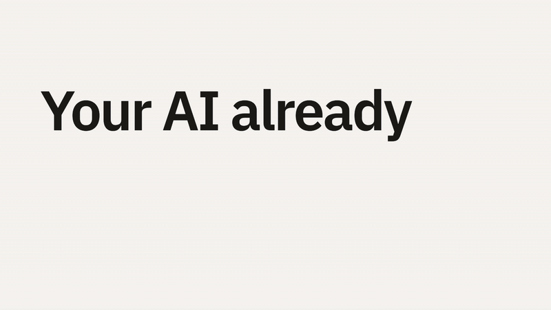

# naqsha

*Naqsha* (نقشہ) is Urdu for map, plan or blueprint.

[](https://github.com/illeniall239/naqsha/releases/download/v0.13.0/naqsha-demo.mp4)

*The demo you are seeing was made with naqsha itself, using `/naqsha:demo`. Click it for the full video.*

A Claude Code plugin that puts you back in charge of AI coding. Claude plans with you on a
page you can see, you make every decision, and no code is written until you approve.

## How it works

1. **Plan.** `/naqsha:plan <what to build>`. Claude asks you questions, reads your
   codebase, researches how it's usually done, and writes a plan as a local webpage. You
   answer each decision on the page. Your project files stay locked while you plan.
2. **Approve.** `/naqsha:approve`. Only you can type it. It checks the plan is complete,
   then unlocks the project.
3. **Build.** `/naqsha:build`. Claude builds the plan step by step, tests first, and asks
   you before changing the plan.

It works for a new app or for a feature in an existing codebase.

## Commands

| Command | What it does |
|---------|--------------|
| `/naqsha:plan <request>` | Start or resume a plan. Locks project files until approved. |
| `/naqsha:design <what to design>` | Design the interface, with live previews and visual options to choose from. |
| `/naqsha:approve` | Approve the plan and unlock the project. Only you can run it. |
| `/naqsha:build` | Build the approved plan, or resume building it. |
| `/naqsha:review [area]` | Review an existing codebase: a map of it, and ranked findings that can become plans. |
| `/naqsha:learn [topic]` | Learn what was built and why, on a page and in chat. |
| `/naqsha:demo <what it's for>` | Make a demo video of your app: pick a storyline, Claude records the real app and directs the film. |
| `/naqsha:help` | The commands, where your project stands, and what to type next. |

Send each command as a message of its own. Plans are saved in `docs/plans/` so you can
commit them.

## Install

Requires Claude Code and `node`.

```sh
claude plugin marketplace add illeniall239/naqsha
claude plugin install naqsha@naqsha
```

Or inside Claude Code: `/plugin marketplace add illeniall239/naqsha`, then
`/plugin install naqsha@naqsha`. Start a new session to load it.

To update:

```sh
claude plugin marketplace update naqsha
claude plugin update naqsha@naqsha
```

To leave planning without approving, delete the `.naqsha/` folder in your project.

To uninstall: `claude plugin uninstall naqsha@naqsha`, then delete `.naqsha/` from any
project you used it in.

## Requirements

- **Everything:** Claude Code, `node` 20 or later, and `git`.
- **`/naqsha:design`:** Playwright, to screenshot the previews it judges. Claude asks
  before installing it.
- **`/naqsha:demo`:** `node` 22 or later, FFmpeg and Playwright. It renders with
  [HyperFrames](https://github.com/heygen-com/hyperframes), fetched through `npx`.

## What to expect

Naqsha is thorough on purpose. It researches, asks before it assumes, has a second agent
review every risky step, and runs your checks. That takes more time and tokens than
letting Claude code straight away. Each plan's page shows what it cost, where the tokens
went and what looked wasted, and the build tunes itself from that without lowering the
bar. It works best on Opus.

## What it does in your project

- **Plans** go in `docs/plans/`, or `plans/` if `docs/` is published as a website. Set
  `"plansDir"` in `.claude/naqsha.json` to choose.
- **Its state** goes in `.naqsha/`, which ignores itself in git.
- **The lock.** While you plan, Claude can't edit files outside the plans folder, and
  changes made through the shell are caught and reported with how to undo them. It keeps
  Claude from coding before you approve. It is a guardrail, not a sandbox: it doesn't
  stop you, or a program that works around it on purpose.
- **Its hooks** run on every prompt and tool call, in every project, in about 30 ms. They
  only act where a plan is being drafted or built.
- **Auto-compaction.** The first naqsha command in a project sets Claude Code to compact
  that project's sessions at about 300k tokens, in `.claude/settings.local.json` (this
  machine only, kept out of git). Ask Claude to turn it off.
- **A progress row.** While Claude or its agents work, a row above the prompt shows
  everything that has run for more than two seconds, in any project: each command, web
  fetch, search or MCP call, with a real bar, rate and time left when its output says
  how far it has got (a render's frames, a download's megabytes, a recording's steps,
  a CI run's jobs)
  and its last line of output otherwise; each subagent with what it's doing now and how
  many tools it has used; and the build's step. It only reads: the output of the
  commands it shows, and the plan.
  It needs a Claude Code recent enough to run plugin hooks modules (checked on 2.1.318
  and later); on an older one the row doesn't appear.

## Privacy

Naqsha has no telemetry and sends nothing anywhere itself. Its pages are served on
`127.0.0.1` behind a random key, and load fonts from Google Fonts and diagrams from
jsDelivr. Cost reports read Claude Code's own logs on your machine. `/naqsha:demo`
fetches HyperFrames from npm (with its telemetry turned off) and its sound effects from
GitHub, and sends a script to a voice provider only if you choose one and say yes.

## Contributing

Issues and pull requests are welcome; [CONTRIBUTING.md](CONTRIBUTING.md) has the setup
and the conventions. Report security issues privately, as [SECURITY.md](SECURITY.md)
says. Changes are listed in [CHANGELOG.md](CHANGELOG.md).

## Credits

The demo and design skills learn from HeyGen's
[HyperFrames](https://github.com/heygen-com/hyperframes) skills and Paul Bakaus's
[Impeccable](https://github.com/pbakaus/impeccable) (both Apache 2.0), and from
Anthropic's work on frontend design. The interface rules also draw on Vercel's Web
Interface Guidelines. Their ideas are restated in naqsha's own words; no code is copied.

## License

[MIT](LICENSE).
